# Esportes-Dash

Painel de esportes para Android TV, com fundo preto, cartões em grafite, azul-gelo e destaque em âmbar no quadro selecionado e na próxima sessão de F1.

> **Baseado no [Free My TV, de simbasjungles e colaboradores](https://github.com/simbasjungles/free-my-tv), e desenvolvido a partir do [TV-Dashboard](https://github.com/ernanimarcondes/TV-Dashboard).** A licença MIT e os avisos dos componentes utilizados estão preservados. Créditos detalhados em [THIRD_PARTY_NOTICES.md](THIRD_PARTY_NOTICES.md).

Este é o projeto independente do painel esportivo. Para a base com Dash Pessoal e suporte à implementação de outros perfis, consulte TV-Dashboard.

## TV e entradas HDMI

Na tela inicial, **TV / HDMI** abre o seletor de entradas. **TV · canais / antena** solicita os canais da televisão; cada HDMI abre a entrada correspondente, com o nome e o estado informados pelo aparelho. Entradas em espera continuam disponíveis para seleção. A disponibilidade dos canais depende da antena e da sintonia já configuradas na TV.

## O painel

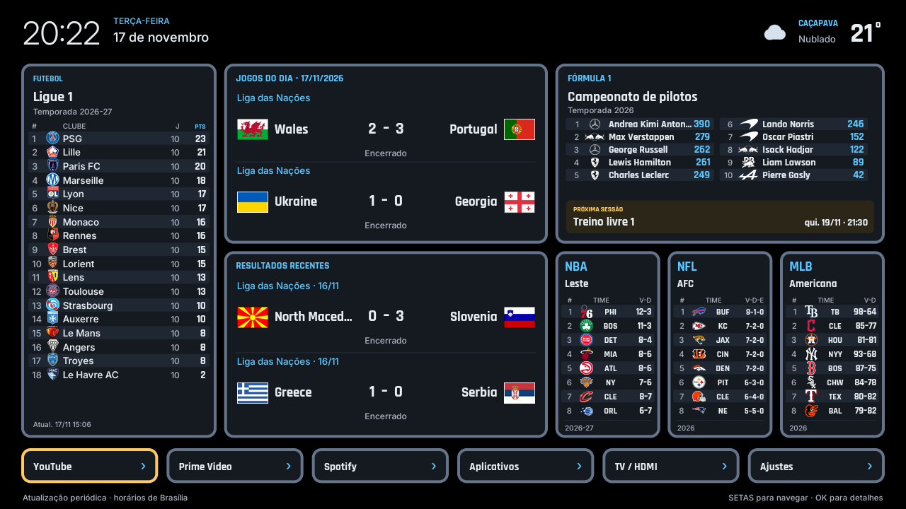

- Classificações: Brasileirão Série A e B, Premier League, Ligue 1, LaLiga, Liga Portugal e Bundesliga. Troca a cada 30 segundos. As classificações de futebol são consultadas novamente a cada 15 minutos enquanto o painel está aberto.
- Jogos do dia: dois confrontos por página, escudos e horários de Brasília, em ordem de horário. Troca a cada 10 segundos.
- Resultados: partidas encerradas nas últimas 72 horas em ordem de data e horário, dois confrontos por página e troca a cada 10 segundos.
- Futebol de clubes e seleções: ligas selecionadas, Libertadores, Sul-Americana, Champions, Europa League, Conference League, copas nacionais e outras competições importantes disponíveis na fonte. Nas copas nacionais, prioriza os clubes das ligas acompanhadas; amistosos priorizam seleções de maior destaque.
- Fórmula 1: programação e traçado vetorial compacto do próximo GP por 30 segundos; classificação de pilotos em páginas consecutivas de dez nomes, com 15 segundos por página; construtores por 15 segundos. A próxima sessão permanece visível. Os 26 circuitos usam o mesmo enquadramento proporcional, setores coloridos e desenho vetorial na resolução da tela; os números das curvas ficam no painel exclusivo de F1. As classificações de pilotos e construtores mostram as logos das equipes em alta qualidade.
- NBA e NFL: até oito times por página, com troca a cada 15 segundos. Todas as páginas da conferência atual são mostradas antes da próxima. NHL e MLB compartilham o quadro: primeiro são exibidas todas as páginas de cada conferência da NHL, depois de cada liga da MLB. OK nos quadros NBA e NFL abre seus respectivos painéis exclusivos; NHL/MLB continuam com a classificação completa em diálogo.
- Relógio, data, clima da cidade configurada e atalhos para aplicativos, TV/HDMI e ajustes.
- Escudos de futebol, seleções, NBA, NFL, NHL e MLB priorizam as versões da ESPN próprias para fundo escuro em todos os quadros, incluindo jogos do dia e resultados recentes. O original é usado como alternativa se a variante não estiver disponível. O carregador mantém o recorte transparente e a redução de alta qualidade para o tamanho real da tela, sem recolorir os escudos. Variantes antigas de Athletico-PR, New York Jets e Cleveland Guardians são evitadas para preservar as identidades atuais.

As classificações de futebol, NBA, NFL, NHL e MLB, os dados de resultados/classificação de F1 e a programação das sessões de F1 são consultados aproximadamente a cada 15 minutos, enquanto o dashboard está aberto. Os jogos de hoje mantêm cinco minutos; os resultados de dias anteriores e o clima, 30 minutos.

Os tempos acima controlam a rotação visual. As consultas de dados são periódicas, com cache local e conservação da última resposta válida. Não é um serviço de placar em tempo real. Não há grade de transmissão de TV. A cobertura depende das fontes e pode ter jogos ausentes, dados indisponíveis ou programação alterada.

## Novo painel exclusivo de Fórmula 1

Na tela principal, selecione o quadro **Fórmula 1** e pressione **OK** no controle: ele abre um painel de F1 em tela cheia. O botão **Voltar** retorna ao Esportes Dash e mantém o quadro selecionado.

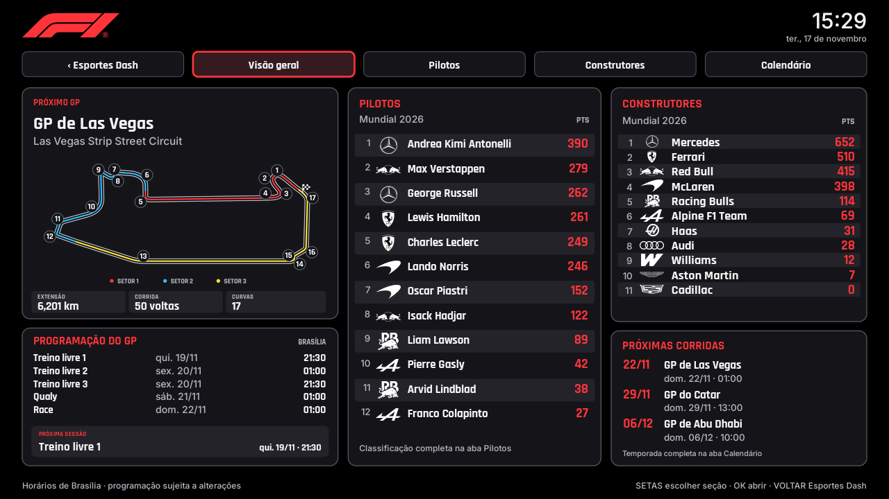

- **Visão geral:** próximo GP, programação dos treinos, Qualy e Race, próxima sessão, classificações e próximas corridas.
- **Pilotos:** classificação completa, logo da equipe, pontos, vitórias e pódios da temporada.
- **Construtores:** logos, pontos, vitórias, pódios e comparação de pontos.
- **Calendário:** datas e horários de Brasília para as corridas da temporada.
- **Resultados:** classificação final de cada GP em ordem do calendário, da primeira corrida até a mais recente, com troca automática a cada 30 segundos. Mostra posições, logos, tempos/status, pontos e a volta mais rápida (piloto e tempo), quando disponível na fonte. Ao chegar à última corrida, recomeça pela primeira.
- **26 circuitos preparados:** traçados com linhas contínuas, curvas numeradas, largada e setores em vermelho, azul e amarelo. O mapa muda automaticamente conforme o próximo GP. A imagem intermediária é renderizada com três vezes a resolução de exibição e reduzida com alta qualidade para o tamanho real da tela. Os nomes dos setores aparecem somente na legenda abaixo do desenho.

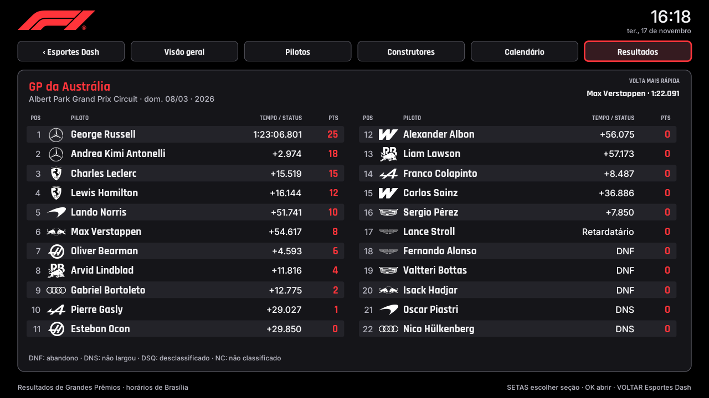

Novos resultados entram automaticamente após a publicação pela fonte, sem recompilar ou reinstalar. Com o painel aberto, a consulta ocorre aproximadamente a cada 15 minutos; ao retornar ao painel, ele verifica se a atualização está vencida. Novas corridas são acrescentadas à sequência do calendário sem interromper o GP exibido. Sem conexão, conserva a última resposta válida.

O painel de F1 usa fundo preto, grafite e vermelho. Os pódios são calculados pelos resultados dos Grandes Prêmios da temporada; sprints não entram nessa contagem. Logos e mapas têm suas fontes indicadas nos assets e nos créditos.

## Painéis de jogos e resultados

Selecione **Jogos do dia** ou **Resultados recentes** na tela principal e pressione **OK**. **Voltar** retorna ao mesmo quadro do Esportes Dash.

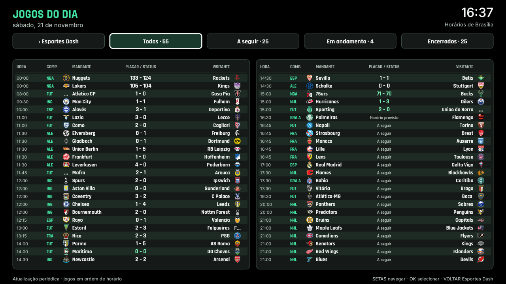

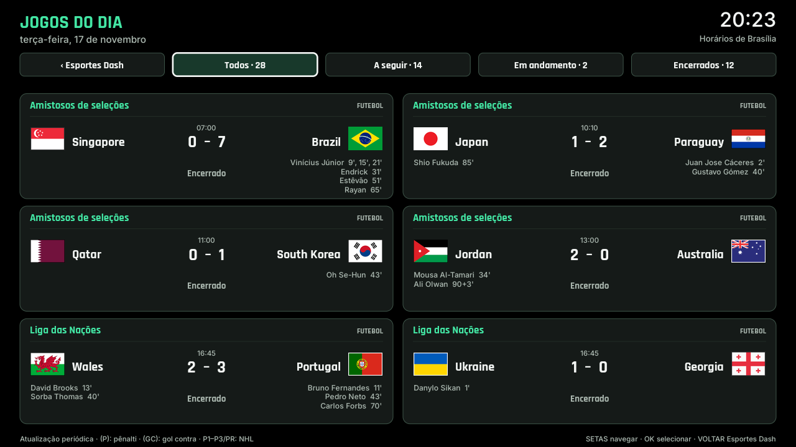

- **Jogos do dia:** fundo preto e verde-esmeralda. A aba Todos mostra uma lista cronológica em duas colunas, com até 48 partidas por página, horários, escudos e placares/status. Os filtros A seguir, Em andamento e Encerrados mantêm seis cartões por página. Os jogos seguem a ordem de horário; horários desconhecidos ficam no final. As páginas mudam automaticamente a cada 20 segundos, sem controles de próxima página.
- **Autores dos gols:** os cartões de futebol e NHL mostram os autores e os momentos dos gols quando a fonte oferece esses dados. No futebol, inclui acréscimos, pênaltis e gols contra; na NHL, período e tempo. Assistências e cobranças de shootout não são apresentadas como gols. Mais de quatro linhas por time alternam a cada cinco segundos. Sem cobertura, informa a indisponibilidade em vez de completar com dados estimados.
- **Resultados recentes:** identidade roxa e aba **Todos** primeiro, seguida pelas datas do mais antigo para o mais novo, sem aba exclusiva para hoje. A janela de resultados é móvel de 72 horas e pode alcançar partes de quatro datas. Todos inclui também os jogos de hoje já encerrados dentro dessa janela.
- **Todos em lista:** até 48 partidas por página, distribuídas em duas colunas, em ordem de data e horário. Quando necessário, muda a página a cada 20 segundos. As abas por data usam os seis cartões com detalhes dos gols.
- **Tela principal compacta:** conserva dois confrontos por quadro e não exibe autores dos gols; eles ficam nos painéis de detalhes.

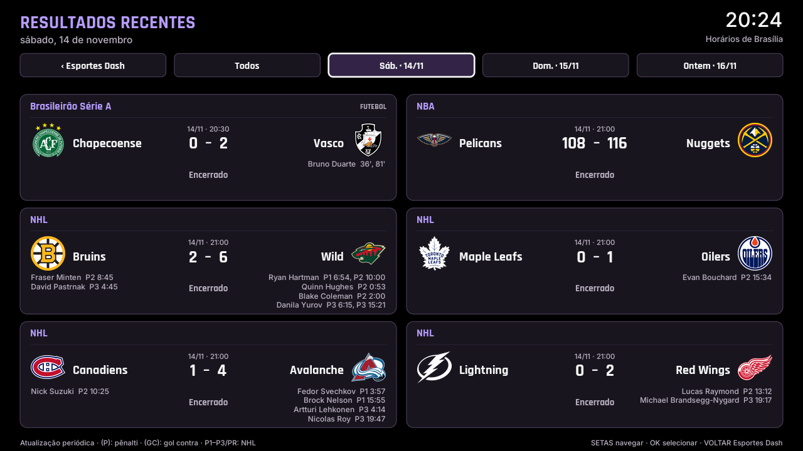

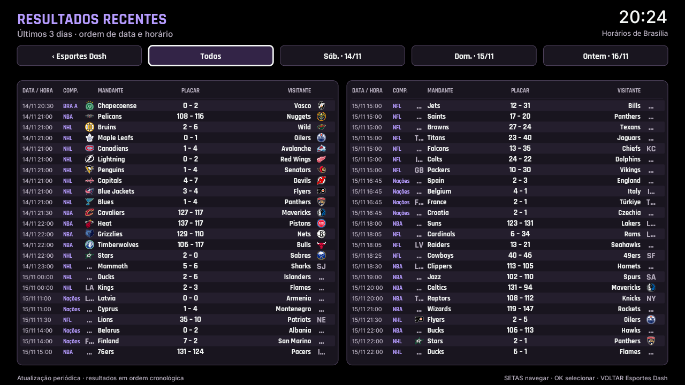

Os novos painéis compartilham os dados e o carregador de escudos da tela principal. As consultas e o processamento de imagens ocorrem em segundo plano, com limites de concorrência e cache local. A tela principal evita redesenhos repetidos quando não há mudança; comandos do controle, imagens e dados novos continuam provocando atualização imediata. Nos detalhes, os temporizadores mantêm as transições de cinco e vinte segundos.

**Continuaremos melhorando os demais quadros do Esportes Dash**, com novos painéis de detalhes e ajustes de visualização e navegação.

## Painéis exclusivos de NBA e NFL

Selecione o quadro **NBA** ou **NFL** e pressione **OK**. **Voltar** retorna ao mesmo quadro da tela principal. A NBA usa azul e vermelho; a NFL, vermelho e azul-marinho, sempre sobre fundo preto.

- **Visão geral:** líderes das duas conferências e resumos dos confrontos atuais e últimos resultados selecionados.
- **Leste/Oeste (NBA) e AFC/NFC (NFL):** classificação completa em duas colunas, com escudos, campanha e aproveitamento. Empates da NFL contam como meia vitória no aproveitamento.
- **Jogos:** na NFL, usa a semana oficial da fonte, incluindo os jogos já encerrados dessa semana. Na NBA, reúne o confronto em andamento de cada time ou seu próximo confronto, sem limitar a um dia ou a um intervalo de datas. Partidas compartilhadas são exibidas uma única vez. Os horários exibidos continuam sendo de Brasília.
- **Resultados:** semana oficial anterior na NFL; na NBA, reúne o último confronto encerrado de cada time, mesmo que tenha ocorrido em datas diferentes, sem duplicar partidas compartilhadas.
- Páginas de jogos e resultados mudam a cada 20 segundos quando necessário, sem botões de próxima página.
- Logos originais das ligas em 500 px, recorte transparente e redução com tratamento de alfa para a resolução física da TV. Os escudos compartilham o carregador de alta qualidade e o cache dos demais quadros.
- Consultas adicionais são feitas somente para a liga aberta. A semana atual da NFL e os placares de hoje são verificados a cada cinco minutos; a semana anterior da NFL é conservada por 30 minutos. Na NBA, os calendários dos times são consultados na abertura e conservados por seis horas; ficam em cache somente os dois últimos confrontos encerrados e até três confrontos atuais/futuros de cada time. Isso limita o processamento sem criar um recorte de datas. Os placares diários mais recentes complementam esse cache. Classificações mantêm 15 minutos. As identidades das semanas da NFL são persistidas no cache, sem inferi-las por intervalos de datas. A cobertura depende da fonte.

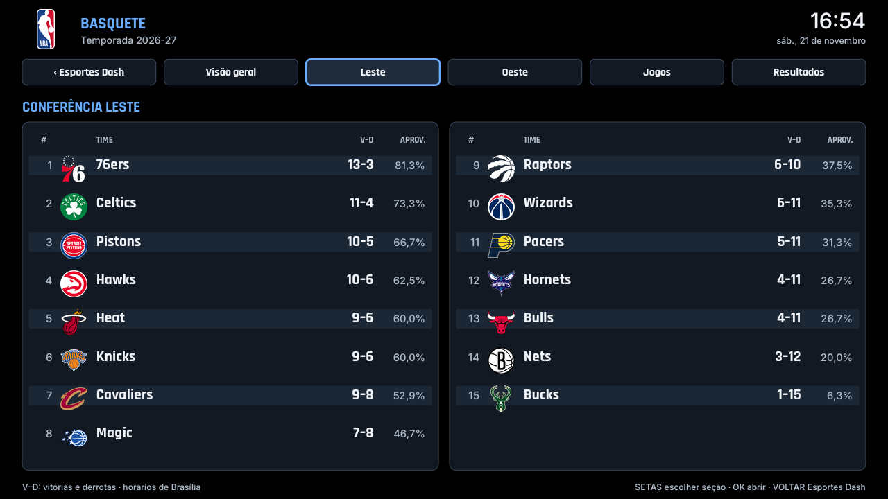

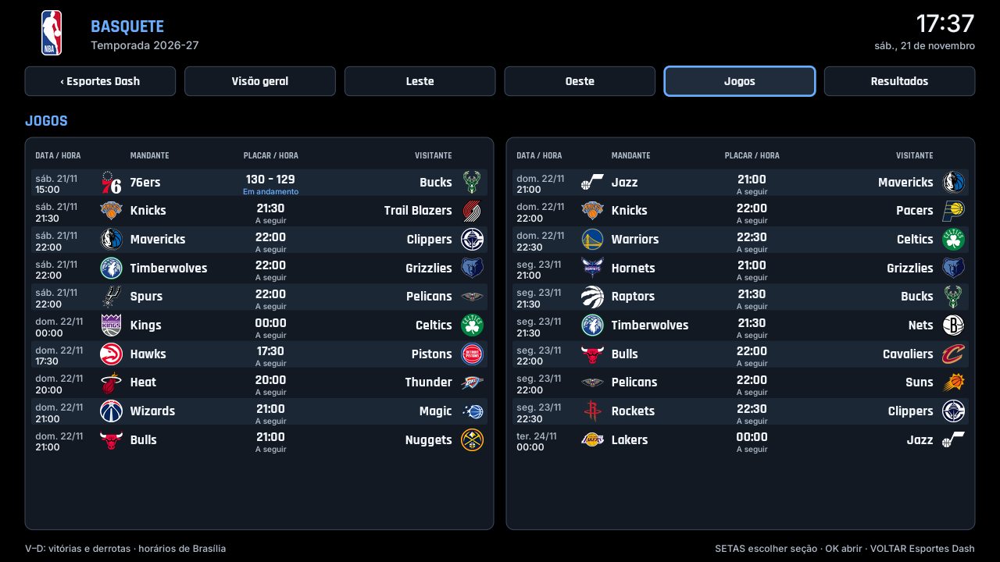

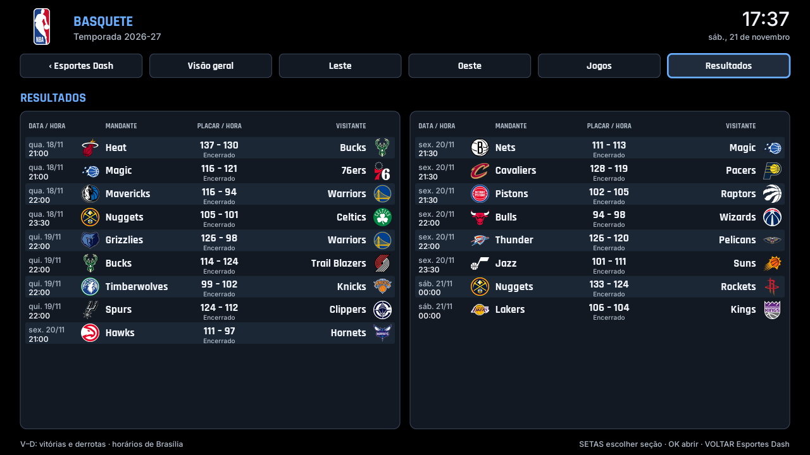

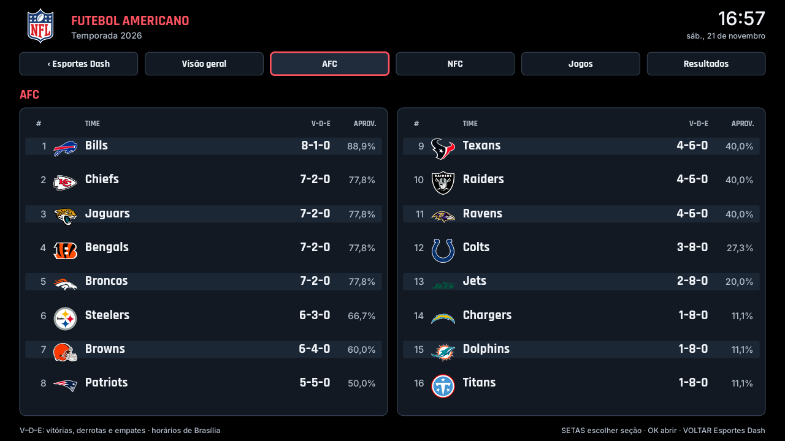

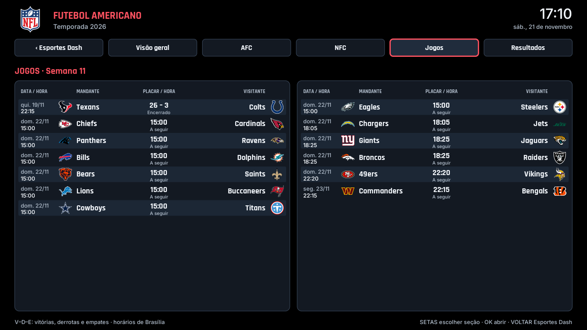

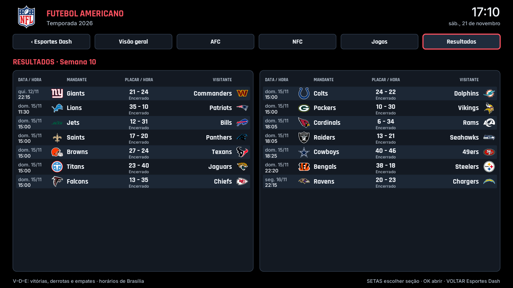

## Compilar

Requisitos: Python 3, JDK 17+, Android SDK com `build-tools;34.0.0` e `platforms;android-34`. Defina `JAVA_HOME` e `ANDROID_HOME`:

```text
python build.py
```

O APK genérico fica em `out/Esportes-Dash.apk`. A compilação usa uma chave de desenvolvimento criada localmente em `.local/debug.keystore`. A chave e o APK ficam fora do Git. Guarde sua própria chave para assinar futuras atualizações; não publique a chave.

O build padrão ignora `config.properties` e não contém cidade, coordenadas ou credenciais pessoais. Para definir padrões locais, copie `config.example.properties` para `config.properties` e compile com `python build.py --personal`. A cidade também pode ser escolhida no aplicativo.

## Compatibilidade e instalação

Android TV 8 ou superior. O layout foi validado em uma TCL com Android 11 e interface de 1280×720. Outros firmwares precisam de validação própria. O modo Original e as proteções do Free My TV foram preservados.

**Esta variante preserva o identificador Android `io.freemytv`, usado pela infraestrutura de recuperação do projeto original. Ela não é instalada lado a lado com TV-Dashboard ou Free My TV.** APKs assinados com chaves diferentes não atualizam uns aos outros. Se estiver trocando de variante e precisar desinstalar, volte primeiro para Original pelo aplicativo, guarde suas configurações e só então remova a variante anterior. Não apague nem desinstale aplicativos de sistema.

Use o [ADB oficial do Android](https://developer.android.com/tools/releases/platform-tools):

```text
adb connect ENDERECO_DA_TV:5555
adb install -r out/Esportes-Dash.apk
```

Na TV, abra Free My TV → Home Screen → Esportes Dash e autorize a depuração do próprio aplicativo quando solicitada. Original continua disponível. Leia as [instruções do Free My TV](https://github.com/simbasjungles/free-my-tv#install) antes de ativar a substituição do launcher. Em alguns firmwares TCL é necessário permitir execução em segundo plano:

```text
adb shell "appops set io.freemytv AUTO_START allow || appops set io.freemytv APP_AUTO_START allow"
```

## Fontes e créditos

- [Free My TV](https://github.com/simbasjungles/free-my-tv): código-base, troca de tela inicial e recuperação; MIT.
- [TV-Dashboard](https://github.com/ernanimarcondes/TV-Dashboard): origem desta adaptação esportiva.
- ESPN: tabelas, jogos e escudos públicos. Seus endpoints e a cobertura podem mudar.
- [Jolpica F1](https://github.com/jolpica/jolpica-f1): calendário, classificações e resultados, voltas mais rápidas e dados usados na contagem de pódios de F1.
- [Formula 1](https://www.formula1.com/): referências oficiais dos circuitos e logos. Esses materiais pertencem aos respectivos titulares e não são abrangidos pela licença MIT do código.
- [Open-Meteo](https://open-meteo.com/): clima das coordenadas configuradas pelo usuário.
- [bacinger/f1-circuits](https://github.com/bacinger/f1-circuits): geometria dos circuitos; MIT, aviso preservado nos assets.
- Inter e Rajdhani: SIL Open Font License, arquivos OFL preservados. Material Symbols: aviso de licença preservado.

Marcas, escudos e dados pertencem aos respectivos titulares. Não há afiliação com TCL, Google, ESPN, Spotify, YouTube, ligas ou equipes.

## Privacidade e desenvolvimento

O painel não usa login de YouTube ou Spotify, não mostra músicas nem consulta inscrições de contas: os botões apenas abrem aplicativos instalados. O código de recuperação e integrações opcionais herdado do Free My TV continua no projeto, sem chaves fornecidas. Consulte [PRIVACY.md](PRIVACY.md).

Antes de publicar:

```text
python tools/check_circuit_data.py
python tools/check_standings_rotation.py
python tools/check_team_logos.py
python tools/check_match_panels.py --json-jar CAMINHO/DO/json.jar
python tools/privacy_check.py
```

Os testes de jogos precisam do JDK 17+ e de um JAR [JSON-Java (org.json)](https://github.com/stleary/JSON-java) fornecido localmente; não fazem consultas de rede nem usam contas. Verificam filtros, ordem cronológica, datas brasileiras, paginação, rotações, autores/minutos, persistência e identidade dos resumos. Os exemplos em `tools/fixtures` contêm somente campos esportivos públicos.

Somente código, assets licenciados e exemplos de dados públicos são versionados. Não publique configurações locais, capturas com dados pessoais, caches, sessões, chaves ou APKs pessoais. Os prints de F1 mostram dados esportivos públicos, relógio e data. O print principal do Esportes Dash foi atualizado a pedido do autor e inclui o clima com a cidade exibida no painel. Nenhuma imagem contém contas ou credenciais.
